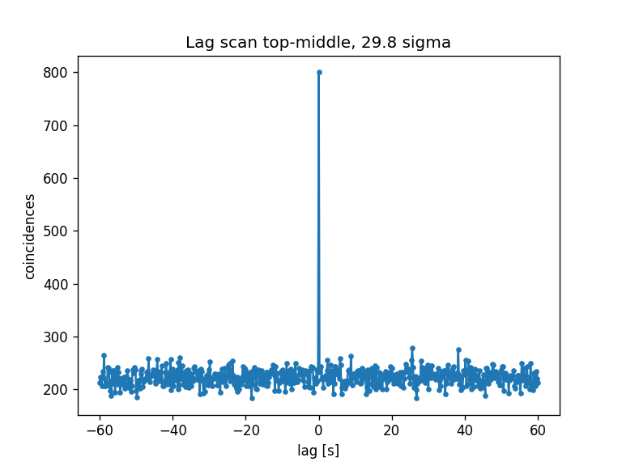
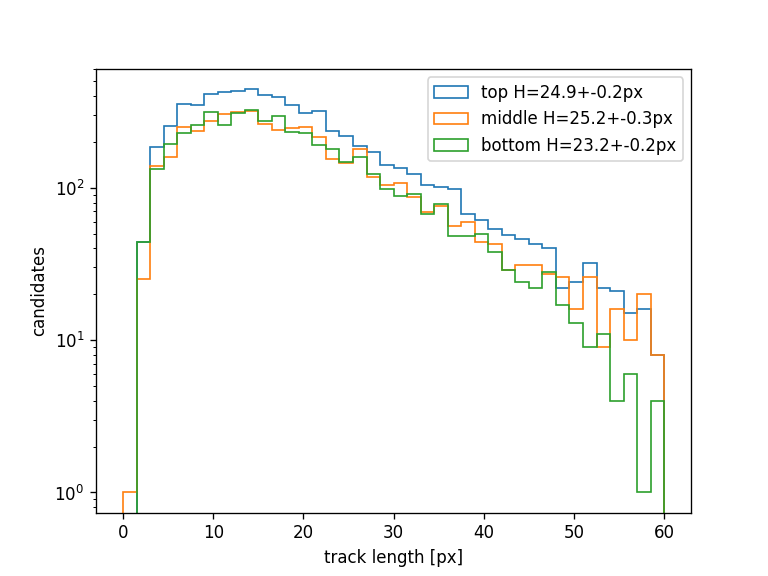
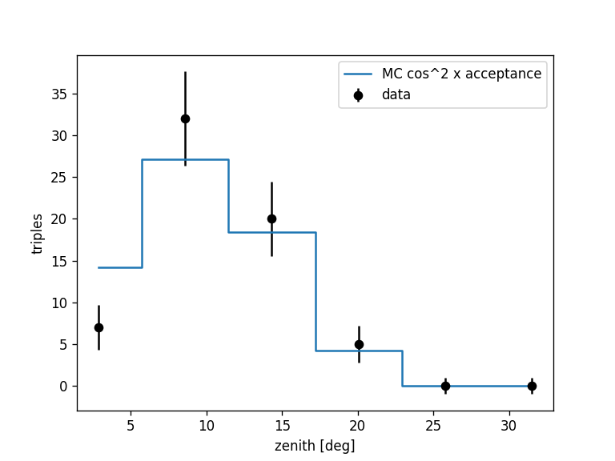

# A Smartphone-CMOS Cosmic-Ray Muon Coincidence Telescope: Design, Expected Rates, and Software Validation on Simulated Data

*Technical report · Muon Telescope project · November 2026 · Turkish version: [paper_tr.md](paper_tr.md)*

> **Status of this report.** This is a design-and-simulation study. **No real phone has yet been run in the stacked configuration, and no cosmic-ray muon has been detected by this system.** Every numerical result below comes from a Monte Carlo simulation or from synthetic event streams produced by the project's own generator. They show that the analysis pipeline recovers known inputs; they are not measurements of nature. Section 7 lists what must still be done on hardware.

## Abstract

Camera sensors in smartphones are thin silicon pixel detectors that register the ionisation left by charged particles. Earlier work (DECO, CREDO) showed that single phones record cosmic-ray tracks, and that the efficiency for muons can be high when the phone's dynamic hot-pixel suppression is off. We describe a system that stacks three Android phones, lenses sealed, so that a muon crossing all three sensors is reconstructed as a straight 3D track. The software covers on-device event triggering, cross-device time synchronisation, coincidence matching with a lag-scan estimate of accidental background, rule-based and CNN cluster classification, track fitting, track-based alignment, and a depletion-layer thickness fit. A Monte Carlo of the assumed geometry predicts 16.4 muons/h through the top sensor, 1.9 double coincidences/h and 0.43 triple coincidences/h (ε = 0.7, 90 % duty). On 500 h of synthetic data the pipeline finds the top–middle coincidence excess at 29.8σ, recovers an injected middle-sensor misalignment of (0.12 mm, −0.08 mm, 0.015 rad) as (0.118 ± 0.016 mm, −0.082 ± 0.016 mm, 0.0147 ± 0.009 rad), and recovers an injected depletion thickness of 25 px as 24.2 ± 0.7 px from coincidence-known angles. We also find that triple coincidences accept only zenith angles below about 25°, which limits any angular-distribution test, and that about 15 % of raw triple matches are fake (a real double plus a noise cluster); a track-like cut on all three clusters is required.

## 1. Introduction

Cosmic-ray muons at sea level cross a horizontal surface at roughly 1 per cm² per minute, with an angular intensity I(θ) ∝ cos²θ. They are minimum-ionising: in silicon a muon deposits about 80 electron–hole pairs per micrometre of path, enough to be seen by a modern camera sensor when the signal is not removed by on-chip processing.

The DECO project (Vandenbroucke et al., arXiv:1510.07665) demonstrated particle detection with phone cameras; its follow-up measured the sensor depletion thickness from track lengths (arXiv:1511.00660). CREDO (arXiv:2009.12314) extends this to a global network. Swaney et al. (arXiv:2107.06332) measured the muon efficiency of phone sensors against scintillator coincidences and, as we understand their result, found efficiencies of roughly 0.7–0.87 for good sensors but about 0.27 for one with dynamic hot-pixel correction enabled, because the image pipeline treats muon tracks as hot pixels. That finding drives a central design rule here: the capture path must disable hot-pixel correction wherever the hardware allows it.

A single phone cannot distinguish muons from gamma "dots", beta "worms", and electronic noise on an event-by-event basis. A bright line on one phone is a muon *candidate*. Stacking sensors adds a physical constraint: only a particle that crosses all planes in the same exposure interval forms a coincidence, and the rate of accidental coincidences can be measured directly by shifting one device's time axis. This report describes a three-phone stack built on that idea and the software that analyses it.

**Out of scope, deliberately.** Navigation by muon time-of-flight needs nanosecond timing (as in the Tokyo muPS/MuWNS systems); a phone frame lasts tens to hundreds of milliseconds. Flux-map positioning needs tens to hundreds of hours per point. Neither is attempted.

## 2. Physical principles

### 2.1 Rates through a small sensor

For a horizontal detector of area A the muon rate is Φ·A with Φ ≈ 1 cm⁻² min⁻¹. For a 7.6 × 5.7 mm sensor (0.433 cm²) this is 26 per hour, or 23.4 per hour after a 90 % duty cycle, before efficiency.

Muons crossing the plane have the pdf ∝ cos³θ sinθ in zenith angle (the extra cosθ is the projected area), which is sampled as cosθ = (1 − u)^{1/4}, u uniform on (0, 1).

### 2.2 Track length and depletion thickness

If the sensitive depth is H and the zenith angle is θ, the track projected on the sensor plane has length L = H tanθ. With the pdf of Section 2.1,

dN/dL ∝ L H⁴ / (L² + H²)³,

normalised as 4 L H⁴ / (L² + H²)³. Truncating at a minimum length L_min gives survival S(L_min) = H⁴ / (L_min² + H²)², which the maximum-likelihood fit in this work uses. L and H are in pixel units; H in micrometres follows from the pixel pitch.

When the zenith angle is known from a coincidence, L = H tanθ + l₀ is fitted linearly; the free intercept l₀ absorbs the pixel footprint of the cluster.

### 2.3 Accidentals

Two devices with event rates R₁, R₂ and exposures T₁, T₂ accidentally coincide at R_acc ≈ R₁R₂(T₁ + T₂). With R ≈ 0.02 s⁻¹ and T = 0.15 s this is 1.2 × 10⁻⁴ s⁻¹, i.e. about 0.4 per hour, comparable to the true double rate. Therefore the accidental rate is measured from data (Section 5.2) rather than assumed.

## 3. System design

### 3.1 Apparatus

Three Android phones (Redmi Note 13, Galaxy A37, Galaxy A12) are stacked with their camera modules aligned vertically and spaced by fixed spacers. Lenses are covered with black tape and aluminium foil, screens are off, and the stack sits in a dark box. The phones run on charge; capture pauses above 42 °C battery temperature and resumes at 40 °C. Sensor positions are measured with a ruler and refined by track-based alignment.

For the simulations in this report we assumed an upper sensor of 7.6 × 5.7 mm and lower sensors of 6.4 × 4.8 mm, with 9 mm between consecutive sensors. **These are assumptions from typical sensor formats, not read from the target phones.** The real sizes come from the Phase 0 capability report, which has not yet been collected.

### 3.2 On-device software (Android, Kotlin, Camera2)

* **Capability probe.** Lists every camera, including physical sub-cameras, with sensor size, pixel array, timestamp source, ISO and exposure ranges, RAW support, hot-pixel / noise-reduction / edge modes, hardware level, and per-format output sizes and minimum frame durations. A script selects the camera and format per phone (manual sensor required; hot-pixel OFF strongly preferred; RAW over YUV; realtime timestamps; then sensor area).
* **Capture.** Manual sensor mode with AE/AF off and noise reduction, edge enhancement, hot-pixel correction and shading off where supported; maximum analog ISO; exposure about 75 % of the frame time. RAW16 is preferred, with the YUV Y plane as fallback.
* **Trigger.** A 60 s dark calibration gives per-pixel mean and standard deviation (Welford) and a hot-pixel mask. Per frame, pixels above μ + kσ (k = 6 by default) are grouped into 8-connected clusters; a frame with more than ten clusters is flagged as a light leak and discarded. Each cluster is stored with centroid, pixel count, summed and maximum ADU, second-moment length, width, angle and eccentricity, plus a 64 × 64 raw crop. Full frames are never written. This logic is plain Kotlin and is unit-tested on the JVM.
* **Timing.** Event times are camera sensor timestamps, which share the `elapsedRealtime` base when the sensor reports a realtime source, mapped to UTC by an NTP-style exchange with the server: the lowest-RTT fraction of samples is fitted for offset and drift. Two independent checks are implemented: GNSS fixes pairing `elapsedRealtimeNanos` with UTC, and a tap test in which accelerometer impulses seen by all phones give the relative offset directly.
* **Upload.** Events are spooled to disk and removed only after server acknowledgement; ingest is idempotent on (device, frame, cluster index), so retries after a dropped link are safe.

### 3.3 Server and analysis (Python)

A FastAPI service provides time sync, ingest (SQLite), run and event queries, coincidence lists with 3D reconstruction, statistics, stability reports and a browser dashboard (Plotly and Three.js). Analysis modules are pure functions and also run as a command-line tool.

## 4. Monte Carlo expectation

Muons are sampled on the top-sensor plane with the pdf of Section 2.1 and propagated in straight lines to the lower planes; efficiency ε is applied as an exact weight. With 2 × 10⁶ muons, ε = 0.7 for every sensor and 90 % duty:

| Quantity | Value |
|---|---|
| Through top sensor | 23.4 / h |
| Recorded by top sensor | 16.4 / h |
| P(geometric hit on middle \| through top) | 16.6 % |
| P(geometric hit on all three \| through top) | 5.3 % |
| Double coincidence top + middle | 1.91 ± 0.003 / h |
| Triple coincidence | 0.425 ± 0.001 / h (one per ≈ 2.4 h) |

Our first back-of-envelope estimate had the triple rate at about 0.25 / h, based on a 3 % geometric acceptance. The simulation gives 5.3 %, so the rate is about 1.7 times higher; the Monte Carlo value is the one to use for this geometry.

**Acceptance versus zenith angle** (geometric, three planes):

| θ bin | Acceptance |
|---|---|
| 0–10° | 0.488 |
| 10–20° | 0.146 |
| 20–30° | 0.004 |
| > 30° | 0 |

Triple coincidences therefore constrain the angular distribution only over roughly 0–25°. Wider angles require double coincidences with the (larger) spacing between two sensors, or a larger gap.

## 5. Analysis methods

### 5.1 Coincidence matching

Events from two devices are matched when their exposure intervals [t, t + T_exp] overlap within a small margin (5 ms by default). A triple requires all three pairs to overlap. Because a phone is blind between exposures, a muon that arrives during read-out is lost; the simulation reproduces this, which sets the effective duty cycle.

### 5.2 Accidental background and significance

The time axis of one device is shifted by k frame periods (k = ±2 … ±300 for a ±60 s scan) and the pairs are recounted. The mean over non-zero lags estimates the accidental count at zero lag. Significance uses the Li and Ma formula (their Eq. 17) with α equal to one over the number of background lags. A real coincidence must show an isolated excess at zero lag; a broad hump would indicate correlated noise or a synchronisation problem.

### 5.3 Classification

A rule-based classifier uses the second-moment width, length and pixel count to label clusters as dot, worm or track. A track label on one phone is still only a candidate. Coincidence-confirmed clusters provide labels for evaluation and, once several hundred exist, for a small CNN (two convolution layers on a 32 × 32 crop). On real data the CNN's negative class is contaminated by single muons, which is acceptable because background dominates.

### 5.4 Reconstruction, alignment and H

Pixel coordinates are converted to millimetres with the pixel pitch and placed in the stack frame using the sensor poses. A total-least-squares 3D line is fitted through the hits; its direction gives the zenith angle and the perpendicular distances are residuals. Alignment adjusts translation and rotation of a free sensor so that robust (soft-L1) residuals shrink; at least two sensors stay fixed, otherwise the line absorbs the shifts. H is fitted by maximum likelihood to single-phone track candidates, and by the linear L–tanθ fit on coincident tracks.

## 6. Validation on synthetic data

The generator produces muons with the Monte Carlo of Section 4 on an enlarged plane, so lower sensors also see muons that miss the top sensor, plus gamma dots (1/min/device), beta worms (0.3/min/device), 2 ms timing jitter, 0.15 s exposure in a 0.2 s frame, and different frame phases per device. The true H is 25 px, pixel pitch 1 µm, and the middle sensor is misaligned by (0.12 mm, −0.08 mm, 0.015 rad). The results use 500 h (seed 11).

| Test | Injected | Recovered |
|---|---|---|
| Top–middle zero-lag excess | – | 800 pairs vs 223 background, excess 577, **29.8σ** |
| Triple matches | – | 75 raw → 64 with track-like clusters |
| Middle alignment | (0.12 mm, −0.08 mm, 0.015 rad) | (0.118 ± 0.016, −0.082 ± 0.016, 0.0147 ± 0.009); median miss distance 0.151 → 0.0026 mm |
| H, single-phone MLE | 25 px | top 24.9 ± 0.2, middle 25.2 ± 0.3, bottom 23.2 ± 0.2 |
| H, coincidence calibration | 25 px | 24.2 ± 0.7 (n = 64) |
| Zenith, cos^k fit | k = 2 | best k = 0 (χ² = 4.5), k = 2 gives χ² = 4.9, 5 d.o.f. |
| Rule classifier | – | dots, worms 100 %; 68 of 16 443 true tracks called dots (very short, near-vertical) |

Several findings qualify these numbers:

1. **The zenith test cannot discriminate.** With 64 triples and the narrow acceptance of Section 4, cos⁰ and cos² fit equally well. Real data will need hundreds of triples and double coincidences for wider angles.
2. **Fake triples are common.** A real double plus a noise cluster at the third sensor accounts for about 15 % of the raw triples in the 500 h run (11 of 75, an upper bound because the cut also removes a few real ones), and in one 48 h trial it was about a third. Requiring all three clusters to be track-like removes them, but it also drops some real triples whose clusters are very short (our test only guarantees that at least 80 % of real triples survive; the loss was not measured more precisely).
3. **A systematic bias remains.** The bottom-sensor H lies 7σ below the truth, because the track-class cut and L_min truncate the short-track population. On real data the systematic uncertainty has to be quoted separately.
4. **The coincidence H calibration has a short lever arm.** Triples sample tanθ below about 0.45, so the slope uncertainty is large unless many tracks are collected.
5. **The accidental-versus-window curve is stepped,** because the frame period (0.2 s) and device phase offsets (0 / 37 / 91 ms) quantise which shifted intervals overlap.

The pipeline was also exercised end to end in an Android emulator, with the capture service generating synthetic dark frames in place of a camera: calibration, trigger, time sync, upload, crop transfer and simulated tap events all reached the server. That test exposed a missing sensor-rate permission, which was fixed. It says nothing about camera behaviour.

## 7. Limitations and remaining work

Not yet done, and required before any physical claim:

* **Hardware capability reports** for the three target phones, and the camera / format / ISO decisions that depend on them. Until then, sensor sizes and pixel pitches used here are assumptions.
* **Verification of the capture path on real cameras**, in particular that hot-pixel correction is really off, that RAW16 works, and that cluster rates are stable (±20 % hourly) over an 8 h run.
* **Measured inter-device time offset** below 5 ms by the tap test, compared with the NTP-style and GNSS estimates.
* **Real-data coincidence excess** at 5σ or better with the accidental background from a lag scan, and a comparison of the measured rates with Section 4. If no excess appears, the reason must be reported.
* **Real zenith distribution**, depletion thickness per phone with systematic errors, and optionally a roof versus basement flux ratio.
* The simulation assumes independent, perfectly efficient trigger thresholds and a Gaussian noise floor; real sensors have non-Gaussian tails, row noise, and temperature dependence.

## 8. Conclusion

We have designed a stackable smartphone muon telescope and written the full software chain from trigger to physics fit. A Monte Carlo of the assumed geometry predicts about 0.43 triple coincidences per hour and shows that triple coincidences see only near-vertical muons. On synthetic data the pipeline recovers injected coincidence excess, alignment and depletion thickness, and exposes two practical hazards (fake triples and a narrow angular lever arm). The next step is not more software: it is putting the stack on a bench, running the probe on the three phones, and taking the first long run.

## Reproducibility

Code, tests, configuration and figures are in the repository. `python -m pytest -q` runs the 23 Python tests; `python sim/mc.py` reproduces Section 4; `python scripts/make_results.py --synthetic --hours 500` reproduces Section 6 (figures in `docs/figures/`); the Android unit tests run with `./gradlew testDebugUnitTest`. All random generators are seeded.

## References

1. Vandenbroucke, J., et al. *Detecting particles with cell phones: the Distributed Electronic Cosmic-ray Observatory.* arXiv:1510.07665.
2. Vandenbroucke, J., et al. *Measurement of camera image sensor depletion thickness with cosmic rays.* JINST 11 (2016) P04019, arXiv:1511.00660.
3. Swaney, J., et al. *Measurement of Smartphone Sensor Efficiency to Cosmic Ray Muons.* arXiv:2107.06332.
4. CREDO Collaboration. arXiv:2009.12314.
5. Li, T.-P., and Ma, Y.-Q. *Analysis methods for results in gamma-ray astronomy.* Astrophys. J. 272 (1983) 317.
