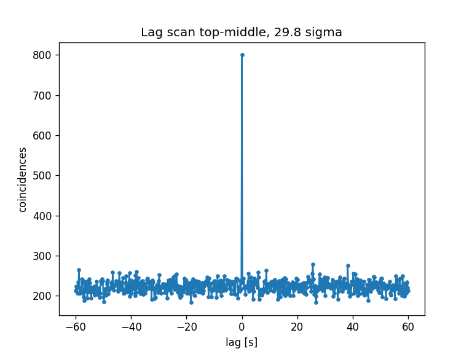
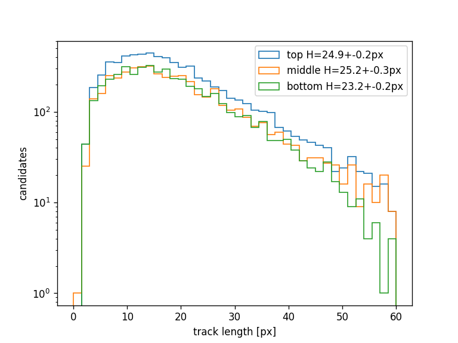
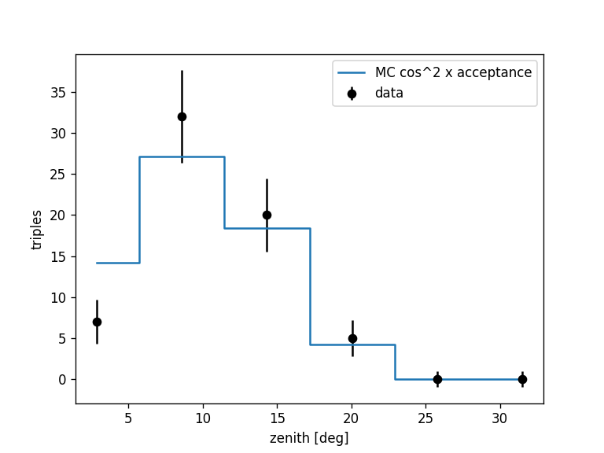

# Telefon CMOS Sensörlü Kozmik Işın Müon Çakışma Teleskobu: Tasarım, Beklenen Oranlar ve Simüle Veride Yazılım Doğrulaması

*Teknik rapor · Muon Telescope projesi · Kasım 2026 · İngilizce sürüm: [paper.md](paper.md)*

> **Bu raporun durumu.** Bu bir tasarım ve simülasyon çalışmasıdır. **Yığılmış düzende henüz hiçbir gerçek telefon çalıştırılmadı ve bu sistemle hiçbir kozmik ışın müonu algılanmadı.** Aşağıdaki tüm sayılar Monte Carlo simülasyonundan ya da projenin kendi üretecinin sentetik olay akışından gelir. Analiz hattının bilinen girdiyi geri bulduğunu gösterirler; doğanın ölçümü değildirler. Bölüm 7, donanımda yapılması gerekenleri listeler.

## Özet

Akıllı telefon kamera sensörleri, yüklü parçacıkların bıraktığı iyonlaşmayı kaydeden ince silisyum piksel dedektörleridir. Önceki çalışmalar (DECO, CREDO) tek telefonların kozmik ışın izlerini kaydettiğini ve telefonun dinamik sıcak piksel bastırması kapalıyken müon veriminin yüksek olabildiğini gösterdi. Biz, lensleri kapatılmış üç Android telefonu üst üste dizip üçünün sensöründen de geçen bir müonu 3B doğru olarak yeniden oluşturan bir sistem anlatıyoruz. Yazılım; cihaz üstü olay tetikleme, cihazlar arası zaman senkronu, rastlantısal arka planı gecikme taramasıyla tahmin eden çakışma eşleme, kural tabanlı ve CNN küme sınıflandırma, iz fit'i, izlere dayalı hizalama ve tükenim katman kalınlığı fit'ini kapsar. Varsayılan geometrinin Monte Carlo'su (ε = 0,7, %90 çalışma oranı) üst sensörden saatte 16,4 müon, saatte 1,9 ikili ve 0,43 üçlü çakışma öngörür. 500 saatlik sentetik veride hat, top–middle çakışma fazlalığını 29,8σ ile bulur; enjekte edilen orta sensör kayıklığını (0,12 mm, −0,08 mm, 0,015 rad) (0,118 ± 0,016 mm, −0,082 ± 0,016 mm, 0,0147 ± 0,009 rad) olarak geri çıkarır; enjekte edilen 25 piksellik tükenim kalınlığını çakışmayla bilinen açılardan 24,2 ± 0,7 piksel bulur. Ayrıca üçlü çakışmaların yalnızca yaklaşık 25°'nin altındaki zenit açılarını kabul ettiğini (bu, açısal dağılım testini sınırlar) ve ham üçlü eşleşmelerin yaklaşık %15'inin sahte olduğunu (gerçek bir ikili + gürültü kümesi) gördük; üç kümenin de iz-benzeri olması şartı gereklidir.

## 1. Giriş

Deniz seviyesindeki kozmik ışın müonları yatay bir yüzeyi yaklaşık dakikada cm² başına 1 kez geçer; açısal şiddet I(θ) ∝ cos²θ'dır. Minimum iyonlaştırıcıdırlar: silisyumda yol başına mikrometrede yaklaşık 80 elektron-boşluk çifti bırakırlar; sinyal çip üstü işlemeyle silinmezse modern bir kamera sensörünün görebileceği düzeydedir.

DECO projesi (Vandenbroucke ve ark., arXiv:1510.07665) telefon kameralarıyla parçacık algılamayı gösterdi; devam çalışması sensör tükenim kalınlığını iz uzunluklarından ölçtü (arXiv:1511.00660). CREDO (arXiv:2009.12314) bunu küresel bir ağa genişletir. Swaney ve ark. (arXiv:2107.06332) telefon sensörlerinin müon verimini sintilatör çakışmalarıyla ölçtü; anladığımız kadarıyla iyi sensörlerde yaklaşık 0,7–0,87, dinamik sıcak piksel düzeltmesi açık bir sensörde ise yaklaşık 0,27 buldu, çünkü görüntü hattı müon izlerini sıcak piksel sanıyor. Bu bulgu burada merkezi bir tasarım kuralını belirler: donanım izin veriyorsa çekim hattında sıcak piksel düzeltmesi kapatılmalıdır.

Tek bir telefon, gama "noktaları", beta "solucanları" ve elektronik gürültüden müonu olay bazında ayıramaz. Tek telefondaki parlak çizgi bir müon *adayıdır*. Sensörleri üst üste dizmek fiziksel bir kısıt ekler: yalnızca aynı pozlama aralığında tüm düzlemleri geçen parçacık çakışma oluşturur ve rastlantısal çakışma oranı, bir cihazın zaman ekseni kaydırılarak doğrudan ölçülebilir. Bu rapor bu fikre dayalı üç telefonlu bir yığını ve onu analiz eden yazılımı anlatır.

**Bilerek kapsam dışı.** Müon uçuş süresiyle konum bulma nanosaniye zamanlama gerektirir (Tokyo muPS/MuWNS sistemlerindeki gibi); telefon karesi onlarca–yüzlerce milisaniyedir. Akı haritasıyla konum, nokta başına onlarca–yüzlerce saat ister. İkisi de denenmemiştir.

## 2. Fiziksel temel

### 2.1 Küçük bir sensörden geçen oran

A alanlı yatay bir dedektör için müon oranı Φ·A'dır, Φ ≈ 1 cm⁻² dk⁻¹. 7,6 × 5,7 mm'lik (0,433 cm²) bir sensör için bu saatte 26, %90 çalışma oranıyla 23,4'tür (verimden önce).

Düzlemi geçen müonların zenit pdf'i ∝ cos³θ sinθ'dır (fazladan cosθ izdüşüm alanıdır); örnekleme cosθ = (1 − u)^{1/4}, u ~ U(0,1) ile yapılır.

### 2.2 İz uzunluğu ve tükenim kalınlığı

Duyarlı derinlik H, zenit açısı θ ise sensör düzlemine izdüşen iz uzunluğu L = H tanθ'dır. Bölüm 2.1'in pdf'iyle

dN/dL ∝ L H⁴ / (L² + H²)³,

normalize hali 4 L H⁴ / (L² + H²)³. Asgari L_min'de kesince sağkalım S(L_min) = H⁴ / (L_min² + H²)² olur; bu çalışmadaki en çok olabilirlik fit'i bunu kullanır. L ve H piksel birimindedir; µm cinsinden H piksel aralığından gelir.

Zenit açısı çakışmadan biliniyorsa L = H tanθ + l₀ doğrusal fit edilir; serbest kesişim l₀ kümenin piksel ayak izini emer.

### 2.3 Rastlantısallar

Olay oranları R₁, R₂, pozlamaları T₁, T₂ olan iki cihaz rastlantısal olarak R_acc ≈ R₁R₂(T₁ + T₂) oranında çakışır. R ≈ 0,02 s⁻¹ ve T = 0,15 s için bu 1,2 × 10⁻⁴ s⁻¹, yani saatte yaklaşık 0,4'tür; gerçek ikili oranla karşılaştırılabilir. Bu yüzden rastlantısal oran varsayılmaz, veriden ölçülür (Bölüm 5.2).

## 3. Sistem tasarımı

### 3.1 Düzenek

Üç Android telefon (Redmi Note 13, Galaxy A37, Galaxy A12), kamera modülleri dikey hizalı ve sabit ara parçalarla aralıklı olarak üst üste dizilir. Lensler siyah bant ve alüminyum folyoyla kapatılır, ekranlar kapalıdır, yığın karanlık bir kutudadır. Telefonlar şarjda çalışır; pil sıcaklığı 42 °C'yi geçince çekim durur, 40 °C'de devam eder. Sensör konumları cetvelle ölçülür ve izlere dayalı hizalamayla iyileştirilir.

Bu rapordaki simülasyonlarda üst sensör 7,6 × 5,7 mm, alt sensörler 6,4 × 4,8 mm ve ardışık sensörler arası 9 mm varsaydık. **Bunlar tipik sensör formatlarından varsayımdır, hedef telefonlardan okunmamıştır.** Gerçek boyutlar henüz toplanmamış olan Faz 0 yetenek raporundan gelecektir.

### 3.2 Cihaz üstü yazılım (Android, Kotlin, Camera2)

* **Yetenek taraması.** Fiziksel alt kameralar dahil tüm kameraları; sensör boyutu, piksel dizisi, zaman damgası kaynağı, ISO ve pozlama aralıkları, RAW desteği, sıcak piksel / gürültü azaltma / kenar modları, donanım seviyesi ve format başına çıkış boyutları ile asgari kare süreleriyle listeler. Bir script telefon başına kamera ve formatı seçer (manuel sensör şart; sıcak piksel KAPALI güçlü tercih; YUV yerine RAW; gerçek zamanlı zaman damgası; sonra sensör alanı).
* **Çekim.** AE/AF kapalı manuel sensör modu; desteklenen yerde gürültü azaltma, kenar keskinleştirme, sıcak piksel düzeltmesi ve gölgeleme kapalı; maksimum analog ISO; pozlama kare süresinin yaklaşık %75'i. RAW16 tercih edilir, yedek olarak YUV Y düzlemi.
* **Tetikleme.** 60 sn karanlık kalibrasyon piksel başına ortalama ve standart sapmayı (Welford) ve sıcak piksel maskesini verir. Her karede μ + kσ üstündeki pikseller (varsayılan k = 6) 8-komşuluk kümelerine ayrılır; ondan fazla kümeli kare ışık sızıntısı sayılıp atılır. Her küme; ağırlık merkezi, piksel sayısı, toplam ve en büyük ADU, ikinci moment uzunluk/genişlik/açı/eksantriklik ve 64 × 64 ham kırpmayla saklanır. Tam kare asla yazılmaz. Bu mantık saf Kotlin'dir ve JVM'de birim testlidir.
* **Zamanlama.** Olay zamanları, sensör gerçek zamanlı kaynak bildirdiğinde `elapsedRealtime` tabanını paylaşan kamera zaman damgalarıdır; sunucuyla NTP benzeri değiş tokuşla UTC'ye eşlenir: en düşük gidiş-dönüş süreli örnekler ofset ve sürüklenme için fit edilir. İki bağımsız doğrulama yazılmıştır: `elapsedRealtimeNanos` ile UTC'yi eşleyen GNSS konumları ve tüm telefonların ivmeölçerinde görülen darbelerle göreli ofseti doğrudan veren dokunma testi.
* **Yükleme.** Olaylar diske kuyruklanır ve ancak sunucu onayından sonra silinir; alım (cihaz, kare, küme indeksi) üzerinde idempotenttir, bu yüzden bağlantı koptuktan sonra tekrar denemek güvenlidir.

### 3.3 Sunucu ve analiz (Python)

FastAPI servisi; zaman senkronu, alım (SQLite), koşu ve olay sorguları, 3B yeniden oluşturmalı çakışma listeleri, istatistikler, kararlılık raporları ve tarayıcı dashboard'u (Plotly ve Three.js) sağlar. Analiz modülleri saf fonksiyonlardır ve komut satırı aracı olarak da çalışır.

## 4. Monte Carlo beklentisi

Müonlar üst sensör düzleminde Bölüm 2.1'in pdf'iyle örneklenir ve alt düzlemlere doğru çizgi olarak ilerletilir; verim ε tam ağırlık olarak uygulanır. 2 × 10⁶ müon, her sensör için ε = 0,7 ve %90 çalışma oranıyla:

| Büyüklük | Değer |
|---|---|
| Üst sensörden geçen | 23,4 / sa |
| Üst sensörün kaydettiği | 16,4 / sa |
| P(orta sensöre geometrik vuruş \| üstten geçen) | %16,6 |
| P(üçüne geometrik vuruş \| üstten geçen) | %5,3 |
| İkili çakışma üst + orta | 1,91 ± 0,003 / sa |
| Üçlü çakışma | 0,425 ± 0,001 / sa (yaklaşık 2,4 saatte bir) |

İlk kaba tahminimiz üçlü oranı, %3'lük geometrik kabule dayanarak yaklaşık 0,25 / sa veriyordu. Simülasyon %5,3 verir; oran yaklaşık 1,7 kat yüksektir. Bu geometri için Monte Carlo değeri kullanılmalıdır.

**Kabulün zenit açısına bağlılığı** (geometrik, üç düzlem):

| θ aralığı | Kabul |
|---|---|
| 0–10° | 0,488 |
| 10–20° | 0,146 |
| 20–30° | 0,004 |
| > 30° | 0 |

Dolayısıyla üçlü çakışmalar açısal dağılımı yalnızca yaklaşık 0–25° aralığında kısıtlar. Daha geniş açılar için iki sensör arasındaki (daha büyük) açıklıkla ikili çakışmalar ya da daha büyük bir aralık gerekir.

## 5. Analiz yöntemleri

### 5.1 Çakışma eşleme

İki cihazın olayları, pozlama aralıkları [t, t + T_poz] küçük bir pay (varsayılan 5 ms) içinde örtüştüğünde eşleşir. Üçlü için üç çiftin de örtüşmesi gerekir. Telefon pozlamalar arasında kör olduğundan, okuma sırasında gelen müon kaybolur; simülasyon bunu yeniden üretir ve etkin çalışma oranını belirler.

### 5.2 Rastlantısal arka plan ve anlamlılık

Bir cihazın zaman ekseni k kare periyodu kaydırılır (±60 sn tarama için k = ±2 … ±300) ve çiftler yeniden sayılır. Sıfır olmayan gecikmelerin ortalaması sıfır gecikmedeki rastlantısal sayıyı tahmin eder. Anlamlılık Li ve Ma formülüyle (Denklem 17) hesaplanır; α, arka plan gecikme sayısının tersidir. Gerçek bir çakışma sıfır gecikmede yalıtılmış bir fazlalık göstermelidir; geniş bir tümsek, ilişkili gürültüyü ya da senkron sorununu gösterir.

### 5.3 Sınıflandırma

Kural tabanlı sınıflandırıcı, ikinci moment genişliği, uzunluk ve piksel sayısıyla kümeleri nokta, solucan ya da iz olarak etiketler. Tek telefondaki iz etiketi hâlâ yalnızca adaydır. Çakışmayla doğrulanmış kümeler değerlendirme için ve birkaç yüz etiket biriktiğinde küçük bir CNN için (32 × 32 kırpma üzerinde iki evrişim katmanı) etiket sağlar. Gerçek veride CNN'in negatif sınıfı tek müonlarla kirlidir; arka plan baskın olduğundan kabul edilebilir.

### 5.4 Yeniden oluşturma, hizalama ve H

Piksel koordinatları piksel aralığıyla mm'ye çevrilir ve sensör konumlarıyla yığın çerçevesine yerleştirilir. Vuruşlardan toplam en küçük kareler 3B doğrusu fit edilir; yönü zenit açısını, dik uzaklıklar artıkları verir. Hizalama, serbest bir sensörün öteleme ve dönmesini, sağlam (soft-L1) artıklar küçülecek şekilde ayarlar; en az iki sensör sabit kalır, aksi halde doğru kaymaları emer. H, tek telefondaki iz adaylarına en çok olabilirlik ile ve çakışmalı izlere doğrusal L–tanθ fit'iyle bulunur.

## 6. Sentetik veride doğrulama

Üreteç, Bölüm 4'ün Monte Carlo'suyla müonları genişletilmiş bir düzlemde üretir; böylece alt sensörler üst sensörü ıskalayan müonları da görür. Buna ek olarak gama noktaları (dakikada 1/cihaz), beta solucanları (dakikada 0,3/cihaz), 2 ms zaman jitter'ı, 0,2 sn karede 0,15 sn pozlama ve cihaz başına farklı kare fazı eklenir. Gerçek H 25 piksel, piksel aralığı 1 µm, orta sensör (0,12 mm, −0,08 mm, 0,015 rad) kayıktır. Sonuçlar 500 saat (tohum 11) kullanır.

| Test | Enjekte edilen | Geri bulunan |
|---|---|---|
| Top–middle sıfır gecikme fazlalığı | – | 800 çift, 223 arka plan, fazlalık 577, **29,8σ** |
| Üçlü eşleşmeler | – | 75 ham → iz-benzeri kümelerle 64 |
| Orta sensör hizalaması | (0,12 mm, −0,08 mm, 0,015 rad) | (0,118 ± 0,016, −0,082 ± 0,016, 0,0147 ± 0,009); medyan ıskalama 0,151 → 0,0026 mm |
| H, tek telefon MLE | 25 px | top 24,9 ± 0,2, middle 25,2 ± 0,3, bottom 23,2 ± 0,2 |
| H, çakışma kalibrasyonu | 25 px | 24,2 ± 0,7 (n = 64) |
| Zenit, cos^k fit'i | k = 2 | en iyi k = 0 (χ² = 4,5), k = 2 için χ² = 4,9, 5 s.d. |
| Kural sınıflandırıcı | – | nokta ve solucan %100; 16 443 gerçek izden 68'i nokta sanıldı (çok kısa, dikeye yakın) |

Bu sayıları şu bulgular niteler:

1. **Zenit testi ayırt edemiyor.** 64 üçlü ve Bölüm 4'teki dar kabulle cos⁰ ve cos² eşit iyi uyar. Gerçek veride yüzlerce üçlü ve daha geniş açılar için ikili çakışmalar gerekir.
2. **Sahte üçlüler yaygın.** Gerçek bir ikili + üçüncü sensörde bir gürültü kümesi, 500 saatlik koşuda ham üçlülerin yaklaşık %15'ini oluşturur (75'te 11; kesme birkaç gerçeği de elediği için üst sınır). 48 saatlik bir denemede kesme öncesi yaklaşık üçte biriydi. Üç kümenin de iz-benzeri olmasını şart koşmak onları eler, ama kümeleri çok kısa olan bazı gerçek üçlüleri de düşürür (testimiz yalnızca gerçek üçlülerin en az %80'inin kaldığını garanti eder; kayıp daha hassas ölçülmedi).
3. **Bir sistematik yanlılık kalıyor.** Alt sensör H'si gerçeğin 7σ altında, çünkü iz sınıfı kesmesi ve L_min kısa iz popülasyonunu keser. Gerçek veride sistematik belirsizlik ayrıca verilmelidir.
4. **Çakışma H kalibrasyonunun kaldıraç kolu kısa.** Üçlüler tanθ'yı yaklaşık 0,45'in altında örnekler; çok sayıda iz toplanmazsa eğim belirsizliği büyüktür.
5. **Rastlantısal–pencere eğrisi basamaklı,** çünkü kare periyodu (0,2 sn) ve cihaz faz kaymaları (0 / 37 / 91 ms) hangi kaydırılmış aralıkların örtüştüğünü nicemler.

Hat ayrıca bir Android emülatöründe uçtan uca denendi; çekim servisi kamera yerine sentetik karanlık kareler üretti: kalibrasyon, tetikleme, zaman senkronu, yükleme, kırpma aktarımı ve simüle edilmiş dokunma olayları sunucuya ulaştı. Bu test eksik bir sensör hızı iznini ortaya çıkardı ve düzeltildi. Kamera davranışı hakkında hiçbir şey söylemez.

## 7. Sınırlamalar ve kalan işler

Henüz yapılmadı ve herhangi bir fiziksel iddiadan önce gerekli:

* **Üç hedef telefonun donanım yetenek raporları** ve bunlara bağlı kamera / format / ISO kararları. O zamana dek burada kullanılan sensör boyutları ve piksel aralıkları varsayımdır.
* **Çekim hattının gerçek kameralarda doğrulanması;** özellikle sıcak piksel düzeltmesinin gerçekten kapalı olması, RAW16'nın çalışması ve 8 saatlik koşuda küme oranının kararlı (saatlik ±%20) kalması.
* **Dokunma testiyle ölçülen 5 ms altı cihazlar arası zaman ofseti;** NTP benzeri ve GNSS tahminleriyle karşılaştırılacak.
* **Gerçek veride 5σ ya da daha iyi çakışma fazlalığı,** gecikme taramasından rastlantısal arka planla ve ölçülen oranların Bölüm 4 ile karşılaştırılması. Fazlalık görülmezse nedeni raporlanmalıdır.
* **Gerçek zenit dağılımı,** sistematik hatalı telefon başına tükenim kalınlığı ve isteğe bağlı çatı/bodrum akı oranı.
* Simülasyon bağımsız, mükemmel tetikleme eşikleri ve Gauss gürültü tabanı varsayar; gerçek sensörlerde Gauss olmayan kuyruklar, satır gürültüsü ve sıcaklık bağımlılığı vardır.

## 8. Sonuç

Üst üste dizilebilen bir telefon müon teleskobu tasarladık ve tetiklemeden fizik fit'ine kadar tüm yazılım zincirini yazdık. Varsayılan geometrinin Monte Carlo'su saatte yaklaşık 0,43 üçlü çakışma öngörür ve üçlü çakışmaların yalnızca dikeye yakın müonları gördüğünü gösterir. Sentetik veride hat, enjekte edilen çakışma fazlalığını, hizalamayı ve tükenim kalınlığını geri bulur ve iki pratik tuzağı (sahte üçlüler ve dar açısal kaldıraç) ortaya çıkarır. Sıradaki adım daha fazla yazılım değil: yığını tezgâha koymak, probe'u üç telefonda çalıştırmak ve ilk uzun koşuyu almaktır.

## Tekrarlanabilirlik

Kod, testler, yapılandırma ve şekiller depodadır. `python -m pytest -q` 23 Python testini çalıştırır; `python sim/mc.py` Bölüm 4'ü, `python scripts/make_results.py --synthetic --hours 500` Bölüm 6'yı (şekiller `docs/figures/` altında) yeniden üretir; Android birim testleri `./gradlew testDebugUnitTest` ile çalışır. Tüm rastgele üreteçler tohumludur.

## Kaynaklar

1. Vandenbroucke, J., ve ark. *Detecting particles with cell phones: the Distributed Electronic Cosmic-ray Observatory.* arXiv:1510.07665.
2. Vandenbroucke, J., ve ark. *Measurement of camera image sensor depletion thickness with cosmic rays.* JINST 11 (2016) P04019, arXiv:1511.00660.
3. Swaney, J., ve ark. *Measurement of Smartphone Sensor Efficiency to Cosmic Ray Muons.* arXiv:2107.06332.
4. CREDO Collaboration. arXiv:2009.12314.
5. Li, T.-P., ve Ma, Y.-Q. *Analysis methods for results in gamma-ray astronomy.* Astrophys. J. 272 (1983) 317.
